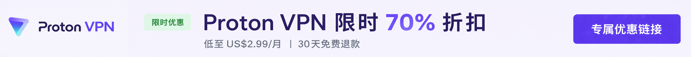
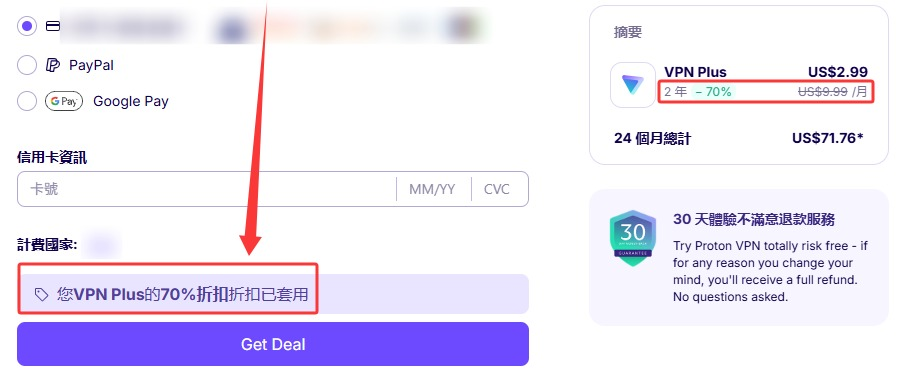

🇨🇳 [中文](README.md) | 🇺🇸 English | 🇷🇺 [Русский](README_RU.md) | 🇮🇷 [فارسی](README_FA.md)

# ProtonVPN Official Website (Updated November 6, 2026)

ProtonVPN Official Website 

Official Website: [protonvpn.com/zh-tw](https://protonvpn.com/zh-tw) 

## Special Offer

`Exclusive Proton VPN Official Partner Offer: Get a 24-month plan for as low as US$2.99/month, approximately 70% off, with a 30-day money-back guarantee.` 

#### 👉 [Claim the Official Proton VPN 70% Discount](https://to.iix.im/p01) 

## Download

🪟 [Windows](https://protonvpn.com/download-windows) ｜ 🍎 [macOS](https://protonvpn.com/download-macos) ｜ 🐧 [Linux](https://protonvpn.com/download-linux) ｜ 
💻 [Chromebook](https://protonvpn.com/download) ｜ 🤖 [Android](https://play.google.com/store/apps/details?id=ch.protonvpn.android) ｜ 🍎 [iPhone / iPad](https://apps.apple.com/app/proton-vpn-fast-secure/id1437005085) ｜ 
🌍 [Chrome](https://protonvpn.com/download-chrome-extension) ｜ 🦊 [Firefox](https://protonvpn.com/download) ｜ 
📺 [Android TV](https://protonvpn.com/download) ｜ 🍎 [Apple TV](https://protonvpn.com/download-appletv) ｜ 🔥 [Fire TV](https://protonvpn.com/download)

## Introduction

Proton VPN is a well-known VPN service developed by the Swiss-based Proton team. It focuses on privacy protection, secure encryption, and a strict no-logs policy. The service supports multiple platforms and offers a permanently free plan.

## Advantages

Headquartered in Switzerland, Proton VPN benefits from strong privacy laws and uses AES-256 encryption along with widely adopted protocols such as WireGuard and OpenVPN.

Its no-logs policy has undergone independent audits, and its client applications are fully open source.

Proton VPN also provides Secure Core multi-hop servers, a Kill Switch, DNS leak protection, and a free plan. Combining security, stability, and ease of use, it is a popular choice among users who prioritize privacy and online security.

## Plan Comparison

### NordVPN vs. Surfshark vs. Proton VPN

| Feature | NordVPN | Surfshark | **Proton VPN (Recommended) ⭐** |
|------|----------|-----------|-------------------------|
| Experience in China | ⭐⭐⭐ | ⭐⭐⭐ | ⭐⭐⭐⭐ |
| Connection Stability | Good | Good | Excellent |
| Privacy Protection | Excellent | Good | **Excellent (Swiss Privacy Laws)** |
| No-Logs Policy | ✅ | ✅ | **✅ (Independently Audited)** |
| Open-Source Clients | ❌ | ❌ | ✅ |
| Independent Security Audits | ✅ | ✅ | ✅ |
| Secure Core Multi-Hop Servers | ❌ | ❌ | ✅ |
| Free Plan | ❌ | ❌ | ✅ |
| Streaming Unblocking | Netflix, Disney+, Hulu | Netflix, Disney+, Hulu | Netflix, Disney+, Hulu |
| P2P Downloads | ✅ | ✅ | ✅ |
| Kill Switch | ✅ | ✅ | ✅ |
| Multi-Hop Connections | ✅ | ✅ | ✅ (Secure Core) |
| Company Location | Panama | Netherlands | **Switzerland** |
| Best For | Speed-focused users | Budget-conscious users | **Users prioritizing privacy, security, and long-term use** |

### Why Do We Recommend Proton VPN?

- 🇨🇭 Headquartered in Switzerland and protected by strong privacy laws
- 🔓 Fully open-source client applications across all supported platforms, ensuring transparency
- 🛡 No-logs policy verified through independent third-party security audits
- 🔒 Secure Core multi-hop connections for enhanced privacy protection
- 🎬 Supports popular streaming platforms such as Netflix, Disney+, and Hulu
- 💻 Available on Windows, macOS, Linux, Android, iPhone, iPad, and other platforms
- 🆓 Offers a permanently free plan, allowing users to try the service before upgrading

> **Note:** VPN connectivity may vary depending on your location and network conditions. If you plan to travel to a region with internet restrictions, it is recommended to download and install the VPN client in advance for a better experience.
