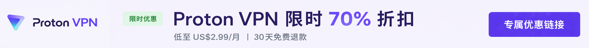
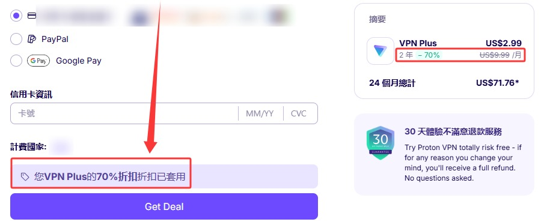

 🇨🇳 [中文](README.md) | 🇺🇸 [English](README_EN.md) | 🇷🇺 [Русский](README_RU.md) | 🇮🇷 فارسی

# آدرس رسمی ProtonVPN (به‌روزرسانی 12 نوامبر 2026)

وب‌سایت رسمی ProtonVPN 

آدرس رسمی: [protonvpn.com/zh-tw](https://protonvpn.com/zh-tw) 

## پیشنهاد ویژه

`تخفیف ویژه شرکای رسمی Proton VPN: اشتراک 24 ماهه با قیمت حداقل US$2.99 در ماه، حدود 70% تخفیف، همراه با ضمانت بازگشت وجه 30 روزه.` 

#### 👉 [دریافت تخفیف رسمی 70 درصدی Proton VPN](https://to.iix.im/p01) 

## دانلود

🪟 [Windows](https://protonvpn.com/download-windows) ｜ 🍎 [macOS](https://protonvpn.com/download-macos) ｜ 🐧 [Linux](https://protonvpn.com/download-linux) ｜ 
💻 [Chromebook](https://protonvpn.com/download) ｜ 🤖 [Android](https://play.google.com/store/apps/details?id=ch.protonvpn.android) ｜ 🍎 [iPhone / iPad](https://apps.apple.com/app/proton-vpn-fast-secure/id1437005085) ｜ 
🌍 [Chrome](https://protonvpn.com/download-chrome-extension) ｜ 🦊 [Firefox](https://protonvpn.com/download) ｜ 
📺 [Android TV](https://protonvpn.com/download) ｜ 🍎 [Apple TV](https://protonvpn.com/download-appletv) ｜ 🔥 [Fire TV](https://protonvpn.com/download)

## معرفی

Proton VPN یکی از سرویس‌های شناخته‌شده VPN است که توسط تیم سوئیسی Proton توسعه یافته است. این سرویس بر حفاظت از حریم خصوصی، رمزنگاری امن و سیاست عدم ثبت گزارش فعالیت کاربران تمرکز دارد.

Proton VPN از پلتفرم‌های مختلف پشتیبانی می‌کند و یک طرح رایگان دائمی نیز ارائه می‌دهد.

## مزایا

دفتر مرکزی Proton VPN در سوئیس قرار دارد و این سرویس از قوانین سخت‌گیرانه این کشور در زمینه حفاظت از حریم خصوصی بهره‌مند است.

Proton VPN از رمزنگاری AES-256 و پروتکل‌های معتبر و پرکاربردی مانند WireGuard و OpenVPN استفاده می‌کند. سیاست عدم ثبت گزارش فعالیت کاربران نیز تحت ممیزی‌های مستقل قرار گرفته است.

نرم‌افزارهای این سرویس کاملاً متن‌باز هستند و قابلیت‌های امنیتی مختلفی ارائه می‌کنند، از جمله سرورهای چندمرحله‌ای Secure Core، قابلیت Kill Switch برای قطع اتصال اینترنت هنگام قطع VPN، محافظت در برابر نشت DNS و یک طرح رایگان.

ترکیب امنیت، پایداری و سهولت استفاده، Proton VPN را به یکی از گزینه‌های محبوب کاربران علاقه‌مند به حفظ حریم خصوصی و امنیت اینترنت تبدیل کرده است.

## مقایسه طرح‌ها

### مقایسه NordVPN، Surfshark و Proton VPN

| ویژگی | NordVPN | Surfshark | **Proton VPN (پیشنهادی) ⭐** |
|------|----------|-----------|-------------------------|
| تجربه استفاده در چین | ⭐⭐⭐ | ⭐⭐⭐ | ⭐⭐⭐⭐ |
| پایداری اتصال | خوب | خوب | عالی |
| حفاظت از حریم خصوصی | عالی | خوب | **عالی (قوانین حریم خصوصی سوئیس)** |
| سیاست عدم ثبت گزارش فعالیت | ✅ | ✅ | **✅ (ممیزی مستقل انجام شده است)** |
| نرم‌افزارهای متن‌باز | ❌ | ❌ | ✅ |
| ممیزی امنیتی مستقل | ✅ | ✅ | ✅ |
| سرورهای چندمرحله‌ای Secure Core | ❌ | ❌ | ✅ |
| طرح رایگان | ❌ | ❌ | ✅ |
| رفع محدودیت سرویس‌های استریم | Netflix، Disney+، Hulu | Netflix، Disney+، Hulu | Netflix، Disney+، Hulu |
| دانلود P2P | ✅ | ✅ | ✅ |
| قابلیت Kill Switch | ✅ | ✅ | ✅ |
| اتصال چندمرحله‌ای | ✅ | ✅ | ✅ (Secure Core) |
| محل استقرار شرکت | پاناما | هلند | **سوئیس** |
| مناسب برای | کاربران علاقه‌مند به سرعت بالا | کاربران علاقه‌مند به قیمت مقرون‌به‌صرفه | **کاربران علاقه‌مند به حریم خصوصی، امنیت و استفاده بلندمدت** |

### چرا Proton VPN را پیشنهاد می‌کنیم؟

- 🇨🇭 دفتر مرکزی در سوئیس قرار دارد و تحت حمایت قوانین سخت‌گیرانه حریم خصوصی است
- 🔓 نرم‌افزارهای تمامی پلتفرم‌ها کاملاً متن‌باز هستند و کدهای آن‌ها به‌صورت عمومی در دسترس قرار دارند
- 🛡 سیاست عدم ثبت گزارش فعالیت کاربران توسط ممیزان امنیتی مستقل بررسی شده است
- 🔒 اتصال چندمرحله‌ای Secure Core برای افزایش حفاظت از حریم خصوصی ارائه می‌شود
- 🎬 از سرویس‌های استریم محبوب مانند Netflix، Disney+ و Hulu پشتیبانی می‌کند
- 💻 از پلتفرم‌های مختلف، از جمله Windows، macOS، Linux، Android، iPhone و iPad پشتیبانی می‌کند
- 🆓 دارای طرح رایگان دائمی است و کاربران می‌توانند پیش از ارتقا به اشتراک پولی، سرویس را آزمایش کنند

> **توجه:** کیفیت و پایداری اتصال VPN ممکن است بسته به موقعیت جغرافیایی و شرایط شبکه متفاوت باشد. اگر قصد سفر به مناطقی با محدودیت اینترنت را دارید، توصیه می‌شود نرم‌افزار VPN را از قبل دانلود و نصب کنید تا تجربه بهتری داشته باشید.
