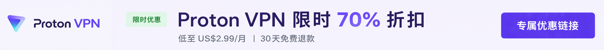
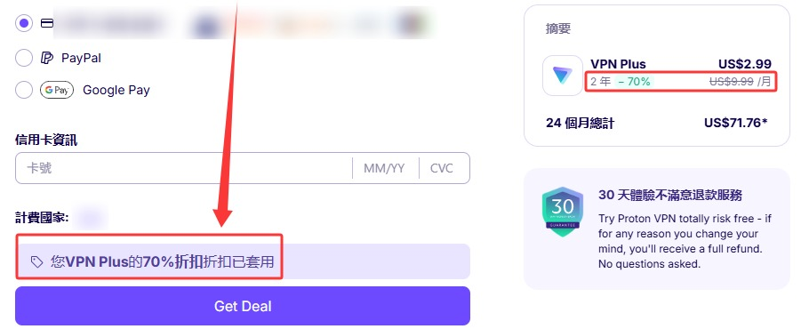

🇨🇳 [中文](README.md) | 🇺🇸 [English](README_EN.md) | 🇷🇺 Русский | 🇮🇷 [فارسی](README_FA.md)

# Официальный сайт ProtonVPN (обновлено 6 ноября 2026)

Официальный сайт ProtonVPN 

Официальный адрес: [protonvpn.com/zh-tw](https://protonvpn.com/zh-tw) 

## Специальное предложение

`Специальное предложение официальных партнёров Proton VPN: подписка на 24 месяца по цене от US$2.99 в месяц, скидка около 70% и гарантия возврата денег в течение 30 дней.` 

#### 👉 [Получить официальную скидку 70% на Proton VPN](https://to.iix.im/p01) 

## Скачать

🪟 [Windows](https://protonvpn.com/download-windows) ｜ 🍎 [macOS](https://protonvpn.com/download-macos) ｜ 🐧 [Linux](https://protonvpn.com/download-linux) ｜ 
💻 [Chromebook](https://protonvpn.com/download) ｜ 🤖 [Android](https://play.google.com/store/apps/details?id=ch.protonvpn.android) ｜ 🍎 [iPhone / iPad](https://apps.apple.com/app/proton-vpn-fast-secure/id1437005085) ｜ 
🌍 [Chrome](https://protonvpn.com/download-chrome-extension) ｜ 🦊 [Firefox](https://protonvpn.com/download) ｜ 
📺 [Android TV](https://protonvpn.com/download) ｜ 🍎 [Apple TV](https://protonvpn.com/download-appletv) ｜ 🔥 [Fire TV](https://protonvpn.com/download)

## Описание

Proton VPN — известный VPN-сервис, разработанный швейцарской командой Proton. Его основные преимущества — защита конфиденциальности, надёжное шифрование и строгая политика отсутствия журналов активности пользователей.

Сервис поддерживает различные платформы и предлагает полностью бесплатный тариф без ограничения срока действия.

## Преимущества

Штаб-квартира Proton VPN находится в Швейцарии, где действуют строгие законы о защите персональных данных и конфиденциальности.

Сервис использует шифрование AES-256 и современные протоколы WireGuard и OpenVPN. Политика отсутствия журналов активности пользователей прошла независимые проверки.

Все клиентские приложения Proton VPN имеют открытый исходный код.

Среди доступных функций безопасности — многопереходные серверы Secure Core, Kill Switch, защита от утечек DNS и бесплатный тариф.

Благодаря сочетанию безопасности, стабильности и простоты использования Proton VPN является популярным выбором среди пользователей, уделяющих особое внимание конфиденциальности и безопасности в интернете.

## Сравнение тарифов

### Сравнение NordVPN, Surfshark и Proton VPN

| Характеристика | NordVPN | Surfshark | **Proton VPN (Рекомендуем) ⭐** |
|------|----------|-----------|-------------------------|
| Удобство использования в Китае | ⭐⭐⭐ | ⭐⭐⭐ | ⭐⭐⭐⭐ |
| Стабильность соединения | Хорошая | Хорошая | Отличная |
| Защита конфиденциальности | Отличная | Хорошая | **Отличная (законы Швейцарии о конфиденциальности)** |
| Политика отсутствия журналов активности | ✅ | ✅ | **✅ (подтверждена независимым аудитом)** |
| Клиенты с открытым исходным кодом | ❌ | ❌ | ✅ |
| Независимый аудит безопасности | ✅ | ✅ | ✅ |
| Многопереходные серверы Secure Core | ❌ | ❌ | ✅ |
| Бесплатный тариф | ❌ | ❌ | ✅ |
| Разблокировка стриминговых сервисов | Netflix, Disney+, Hulu | Netflix, Disney+, Hulu | Netflix, Disney+, Hulu |
| Загрузка через P2P | ✅ | ✅ | ✅ |
| Kill Switch (аварийная блокировка соединения) | ✅ | ✅ | ✅ |
| Многопереходные соединения | ✅ | ✅ | ✅ (Secure Core) |
| Страна регистрации компании | Панама | Нидерланды | **Швейцария** |
| Для кого подходит | Пользователи, которым важна скорость | Пользователи, которым важно соотношение цены и качества | **Пользователи, которым важны конфиденциальность, безопасность и долгосрочное использование** |

### Почему мы рекомендуем Proton VPN?

- 🇨🇭 Штаб-квартира находится в Швейцарии, где действуют строгие законы о защите конфиденциальности
- 🔓 Клиентские приложения для всех платформ имеют полностью открытый исходный код, что обеспечивает прозрачность
- 🛡 Политика отсутствия журналов активности пользователей прошла независимый аудит безопасности
- 🔒 Многопереходные соединения Secure Core обеспечивают дополнительную защиту конфиденциальности
- 🎬 Поддерживает популярные стриминговые сервисы, включая Netflix, Disney+ и Hulu
- 💻 Доступен на Windows, macOS, Linux, Android, iPhone, iPad и других платформах
- 🆓 Предлагает постоянно бесплатный тариф, позволяющий протестировать сервис перед переходом на платную подписку

> **Примечание:** Стабильность VPN-соединения может различаться в зависимости от региона и условий сети. Если вы планируете поездку в страну или регион с ограниченным доступом к интернету, рекомендуется заранее скачать и установить VPN-клиент для более комфортного использования.
